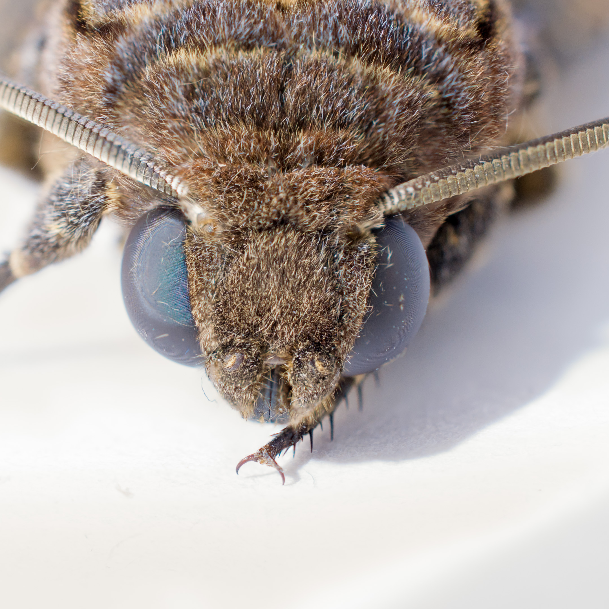

Focus Stacking: It's an image processing technique in which multiple photographs taken at various focal distance to create a greater DOF.

In case of close-up photography/macro photography, this technique comes in very handy.

Above photograph is a focus stack of 5 different images.
